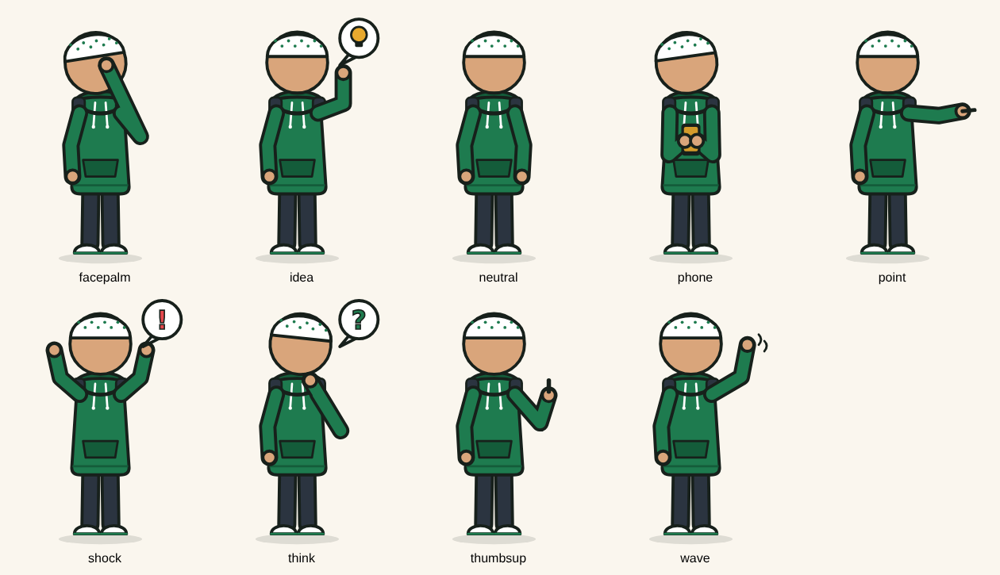

# Halal YT: Video Style Guide

The house style for every Halal YT video. It draws on two reference channels I studied frame by frame (a commentary video and a meme-breakdown video, both faceless, both for a Muslim audience). The ideas are borrowed; the look is our own.

**In one line:** a calm, warm, paper-white world where Hadi stands on screen and the evidence slides in next to him. It's playful when we set up the story and still when we quote Allah or His Messenger ﷺ.

---

## 1. What I learned from the references

| | Reference A (commentary) | Reference B (meme breakdown) |
|---|---|---|
| Canvas | Pure white void, 16:9 | Pure white void, 16:9 |
| Character | Black pictogram stick figure | Hand-drawn bearded man in a kufi and thobe |
| Pace | Few hard cuts (4 in 3:14), but something moves every 2–4 s | 31 shots in 1:47, median shot **2.4 s** |
| Narration | Calm, ~125 words/min, true silence between phrases | Calm, slightly faster, constant background bed |
| First 3 s | Character points → whips off-screen at 1.0 s → subject slides in | Character whips in with motion blur at frame 1, caption appears at 1.2 s |
| Images | Centered "cards" that slide in, overshoot and slowly push in | Images cascade in from the right and stack on top of each other |
| Text | Small handwritten-style sentence lines; key words as colorful bubble-font stickers | 1–3-word stickers around the character, in different colors |
| Emphasis | Giant red ✕ that slams down from full screen onto a face; 3D emoji pop in | Arrow ↓ from slur to translation; red censor bars; colored karaoke highlight on the ayah |
| Sound | Almost dry: voice only, emphasis comes from visuals | Small dings on word pops, clicks on UI, a scribble on the red ✕ |
| Religious text | Hadith shown as a clean card **with source and grading** | Ayah shown full-screen with phrase-by-phrase color highlight and surah:ayah reference |
| Ending | Dua → "Ameen" → subscribe button + subscriber goal + wobbling meme GIF | Subscriber goal + meme GIF |

**What we keep:** the simple white world, a recurring character, image cards instead of footage, short stickers instead of full subtitles, censoring offensive text, and always citing sources.
**What we change:** our own palette and paper color, a faceless character, a fixed meaning for each color, stricter rules for religious content, and more motion design.

---

## 2. Canvas and color

- **Long form:** 1920×1080, 30 fps. **Shorts:** 1080×1920, 30 fps (same rules, everything stacked vertically).
- **Background:** warm paper `#FAF6EE`, never pure white. Optional: a 3% paper-grain texture, never a gradient.

| Token | Hex | Meaning (always the same) |
|---|---|---|
| `ink` | `#17201B` | Outlines, neutral text |
| `paper` | `#FAF6EE` | Background |
| `deen` (green) | `#1E7B4F` | Islamic, correct, halal, "do this" |
| `gold` | `#E8A92E` | Key fact, number, name, "remember this" |
| `warn` (red) | `#E5484D` | Wrong, haram, danger, censor bars |
| `sky` | `#2F80ED` | UI, links, "click here", platforms |

Viewers learn the code: **green = deen, red = warning, gold = the fact to remember.**

---

## 3. Typography

| Use | Font (Google Fonts, free) | Treatment |
|---|---|---|
| Stickers (1–3 words) | **Lilita One** | Color fill + 8 px `ink` outline + hard 6 px down-right shadow in `ink` at 25% |
| Sentence lines | **Nunito** ExtraBold | `ink` on paper, max 7 words per line, centered |
| Arabic (Quran, hadith, terms) | **Amiri** | `ink`, large, never outlined, never animated with bounce |
| UI/labels (handles, sources) | **Nunito** Bold | Small, `ink` at 70% |

Rules:
- **No always-on subtitles.** Text appears only when it adds something: a key word, a number, a quote, a translation.
- Stickers sit **around Hadi** (left/right/above), never covering him.
- At most **3 stickers on screen** at once. Clear them all together on a cut.
- Sentence lines are used for the **message section** (the moral), and they reveal word by word in sync with the narration from faster-whisper timestamps.

---

## 4. Meet Hadi (the channel character)

**Hadi** (هادي, "one who guides") is a calm young Muslim creator who has been through the YouTube grind and now guides others through it.

- **Faceless by design.** No eyes, nose or mouth. That matches the channel (faceless), sidesteps the discomfort some Muslims feel about drawn faces, and makes him instantly recognizable. Emotion comes from **pose, head tilt, props and a symbol bubble**.
- **Look:** a modern young creator. White crochet kufi with green stitch dots, deep-green hoodie with white drawstrings and a front pocket, headphones resting round his neck, dark trousers, white sneakers with a green sole line. Tall proportions (about 4 heads tall), thick dark outlines, flat colors.
- **Height on screen:** about 75% of the frame height in long form, about 35% in Shorts.
- **Poses** (in `brand/hadi/`, generated by `tools/make_hadi.py`):
  `neutral` · `point` · `think` (?) · `shock` (!) · `facepalm` · `thumbsup` · `phone` · `wave` · `idea` (💡)
- **Personality:** friendly older brother. Curious, honest about mistakes, never preachy, never mocking.
- **Placement:** usually left third of the frame, feet at the bottom 10%. Evidence appears on the right two-thirds.
- **Idle life:** never fully still. Gentle 2 px up-down "breathing" bob (2.5 s loop) and a pose change roughly every 4–8 s.
- **Signature moves:**
  - *The hand-off:* Hadi points → he whips out to the left → the subject whips in from the right (his "here, look at this").
  - *The phone check:* Hadi looks at his phone when we show YouTube Studio, analytics or comments.
  - *The bubble:* `?` when asking the viewer something, `!` for a twist, 💡 for the takeaway.
- **Hadi never appears** on the same screen as a Quran ayah or hadith card. He steps aside.

---

## 5. The first 3 seconds

Both references show the hook visual on frame 1 and have something moving by 1.0 s. Our version:

| Time | Picture | Sound |
|---|---|---|
| 0.00 s | Hadi already on screen in a pose that matches the hook (`think`, `shock`, `phone`). No fade-in, no logo, no intro. | First word of the narration starts at frame 1 |
| ~0.3 s | One sticker pops in with the key word of the hook (e.g. **AI VOICE?**) | soft pop |
| ~1.0 s | **The hand-off:** Hadi points, whip, the thing we're talking about slides in big | whoosh |
| ≤3.0 s | The hook question is fully spoken. The viewer knows the topic and why it matters. | — |

Hook formula: **[the thing they've seen] + [the twist they didn't know]**, e.g. "Thousands of Islamic channels use AI voices now. But some of them are reciting the Quran wrong."

---

## 6. Pacing

- **Something new on screen every 1.5–3 s** (a card, a sticker, a pose, a zoom). Never a static frame for more than 4 s.
- A section is 15–45 s, and each new section starts with a hard change (new background card or Hadi re-entering).
- Leave **0.3–0.5 s of air** after a big statement (no new element) so it lands.
- Clips from other videos play in a card at 80–90% of the frame with their own audio. Narration pauses. Keep clips short (under 10 s), trimmed to the moment that matters, with a source label in the corner.

---

## 7. Motion vocabulary

Use only these moves, so every video feels the same family. All durations are at 30 fps.

| Move | Spec | Used for |
|---|---|---|
| **Whip-in** | Slide from off-screen right in 4 frames with horizontal motion blur, overshoot 4% past the target, settle back in 5 frames (ease-out) | New image/card, Hadi entering |
| **Whip-out** | Reverse of whip-in, 3 frames, to the left | Clearing a card |
| **Pop** | Scale 0 → 115% → 100% over 6 frames, slight 3° rotation that settles to 0 | Stickers, emoji, icons |
| **Stamp** | Starts at 300% scale and 0% opacity, slams to 100% in 4 frames, then a 3-frame screen shake (±8 px) | ✕ / ✓ verdicts, "HARAM?" / "HALAL" labels |
| **Push-in** | Slow 100% → 108% scale over the shot's lifetime, linear | Every card on screen longer than 2 s |
| **Cascade** | Each new card whips in on top of the last, older cards shift left 20% and shrink to 85% | Showing "many examples" |
| **Wobble** | Card tilted ±3°, slowly rocking (sine, 2 s loop) | Memes and GIFs only |
| **Highlighter** | A `gold` 35%-opacity bar sweeps left-to-right under a line in 8 frames | Key line in a screenshot or comment |
| **Arrow** | Hand-drawn arrow draws itself in 6 frames between two things | "This means → that" |
| **Censor bar** | Solid `warn` red bar, no text under it visible | Slurs, blasphemy, profanity: **always** |

Screen shake is rare (max once per minute), so it stays special.

---

## 8. Images and cards

- Every still image sits on a **card**: 6 px `ink` border, 18 px rounded corners, soft shadow (0 12 px 30 px, 15%).
- Screenshots (YouTube, comments, Google Translate, YouTube Studio) are shown as **real UI** in a card, with a `sky` cursor that clicks (click sound) when we "use" something.
- Faces of real people being criticized can be shown when they're the subject, but **never mocked or meme-edited**. Use the ✕ stamp on a *claim*, not on a person's face.
- Use our own icons in flat style (same outline weight as Hadi) instead of mixing many emoji styles. Allowed emoji set: ✅ ❌ ⚠️ 💡 🔥 📈. Keep it small and consistent.

---

## 9. Quran and hadith (the respect rules)

These override every other rule.

1. **Dedicated card, full screen, paper background.** Hadi leaves the frame.
2. **Layout:** Arabic in Amiri at the top → English translation below → a source line at the bottom:
   - Quran: `Surah At-Tawbah 9:65`
   - Hadith: `Sahih al-Bukhari 6477 · Grade: Sahih` (**grading is mandatory**, never quote a weak hadith as if it's authentic)
3. **Motion:** fade in over 12 frames, very slow push-in (100% → 103%). **No** whip, pop, stamp, shake, wobble, emoji or stickers.
4. **Highlight in sync:** while the translation is read, the current phrase turns `deen` green (karaoke-style, timed from faster-whisper word timestamps). Arabic stays still.
5. **Sound:** no sound effects on the card at all. Silence + narration only.
6. **Recitation audio:** only from a real reciter, with permission or a license that allows it. **No AI-generated recitation of the Quran on this channel.**
7. Hold the card at least 1 s after the narration finishes.

---

## 10. Sound effects

Voice and sound effects only. Sound effects sit 18–22 dB below the voice and are short (under 0.5 s), so they punctuate and don't distract.

| Sound | Paired with |
|---|---|
| Soft airy **whoosh** | Whip-in / whip-out / hand-off |
| Light **pop** (bubble or cork-like) | Sticker or icon pop |
| Deep **thud** | Stamp (✕, ✓, verdict) |
| **Mouse click** | Cursor clicks in UI screenshots |
| **Keyboard typing** | Typing into a search bar or translator |
| Pencil **scribble** | Arrow drawing, hand-drawn ✕ |
| Single soft **ding** | 💡 idea bubble, the key takeaway |
| Record **scratch** | "Wait…" twist moment (max once per video) |

Rules: one sound per visual event. Never stack two on the same frame. No sounds on Quran/hadith cards or during the dua.

---

## 11. Voice and tone

- Calm, warm, conversational, 130–150 words/min. Short sentences.
- Pattern for every video: **Hook → context (what happened) → the twist or problem → evidence → what Islam says → what you should do → dua → CTA.**
- Humor lives in the setup sections (memes, Hadi's facepalm). It stops completely at the religious evidence.
- Humble framing: "Scholars say…", "Allah knows best." Never issue our own fatwa.
- Correct terms: "the Prophet ﷺ" (show ﷺ on screen), "Allah" (never "God" as a substitute in quotes from Islamic sources).

---

## 12. Ending

1. **Takeaway line** as a sentence-line reveal (green key word).
2. **Short dua** (sentence lines, no sound effects) → "Ameen."
3. **CTA:** Hadi `wave` pose on the left. On the right, a subscribe button pops in, a `sky` cursor clicks it (click + pop), then a goal line: `Goal: 1,000 subscribers` with a counter.
4. End screen: 10–15 s, with two video slots that whip in from the right.

---

## 13. Shorts adaptation (1080×1920)

- Hadi at the bottom-left, smaller (35% of height). Evidence card in the top 60%.
- Stickers bigger (Lilita One at 110 px+), centered above the card.
- Hand-off happens at 0.5 s instead of 1.0 s.
- One idea per Short. End on the key line, not a long CTA. The last frame should loop cleanly into the first.

---

## 14. Production checklist

- [ ] Hook visual on frame 1, topic clear by 3 s
- [ ] Something new every 1.5–3 s, nothing static over 4 s
- [ ] Colors used with their fixed meaning
- [ ] Max 3 stickers on screen
- [ ] Every Quran/hadith quote has a reference (and hadith grading), on a clean card, no sound effects
- [ ] Offensive words censored with red bars
- [ ] Every clip trimmed, labeled with its source
- [ ] One sound per visual event, voice always on top
- [ ] Dua + CTA at the end
